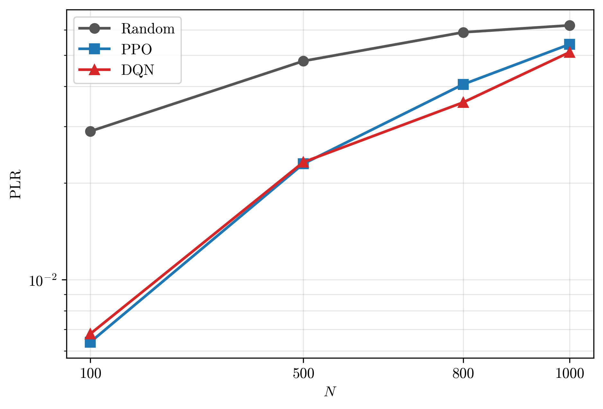
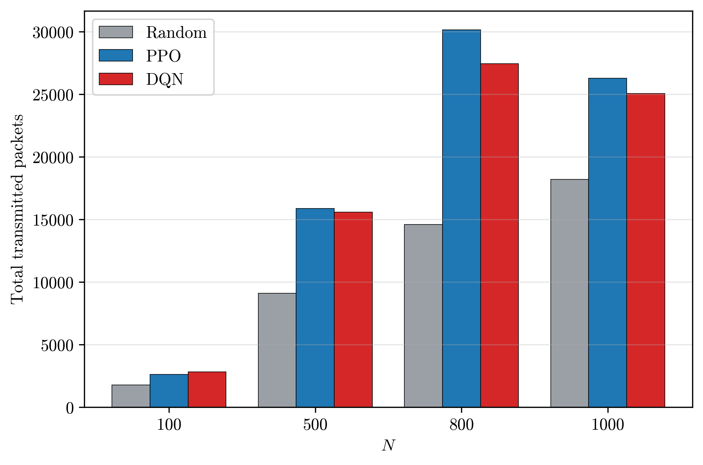
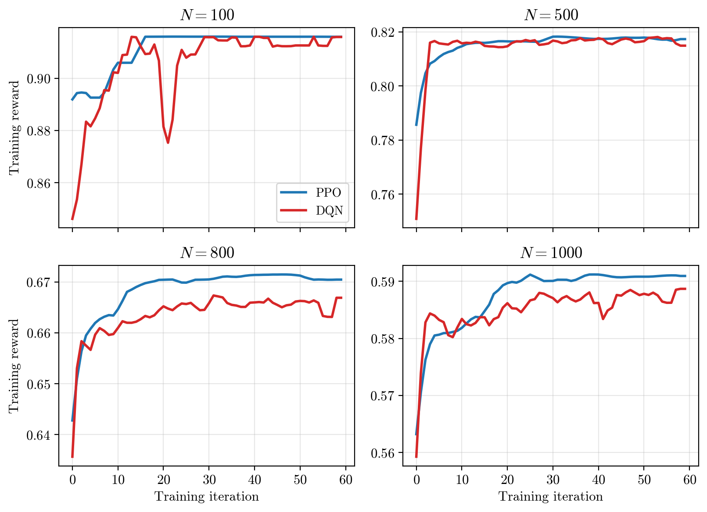
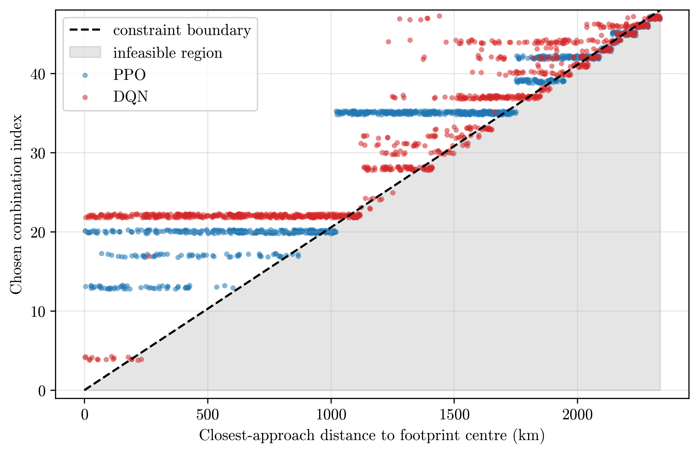

# LoRa-Satellite-RL

**Reinforcement learning (PPO & DQN, implemented from scratch in NumPy) for packet-loss minimization in direct-to-satellite LoRaWAN IoT.**


---

## Overview

Low-Earth-orbit (LEO) satellites can extend LoRaWAN connectivity to remote and
underserved regions, enabling **direct-to-satellite (DtS) IoT**. But as the number
of end devices (EDs) in a satellite's large footprint grows, packets are lost to
two effects: **collisions** between overlapping transmissions, and **Doppler
shift / Doppler rate** caused by the satellite's fast motion.

This project poses the resource-allocation problem as a **reinforcement-learning
task**: for every ED, an agent chooses a transmission configuration — spreading
factor (SF), coding rate (CR), bandwidth (BW) — and a packet start time, so as to
**minimize the network packet-loss ratio (PLR)**. Two agents are trained and
compared: **PPO** (policy-based) and **DQN** (value-based), both written from
scratch in NumPy, and both benchmarked against a random-allocation baseline.

## Approach

- **Physics-based environment.** A self-contained simulator models the satellite
  pass geometry, per-ED visibility windows, analytic Doppler profiles, 64 random
  channels, and collisions computed by direct packet time-overlap.
- **RL formulation.** Per-ED state (window length, timing, channel load, …);
  action = one of 48 SF/CR/BW combinations × a discrete start-time bin; reward =
  mean per-packet success probability, derived from an analytical PLR model.
- **From-scratch algorithms.** PPO (clipped objective, GAE, entropy bonus) and DQN
  (replay buffer, target network, ε-greedy) implemented directly in NumPy — a
  small MLP with manual backprop and Adam, no deep-learning framework.
- **Honest evaluation.** Policies are trained on one network and evaluated on
  **40 held-out networks**; the reported PLR is measured by direct collision
  counting, not by the training surrogate.

## Results

Both learned policies substantially reduce the PLR at every network size, while
transmitting more packets.

**Packet-loss ratio vs. number of EDs (log scale):**



**Total transmitted packets vs. number of EDs:**



**Training reward vs. iteration (convergence of PPO and DQN):**



**Learned policy respects the distance–configuration constraint** (every device
on or above the feasibility boundary):



| EDs (N) | Random PLR | PPO PLR | DQN PLR |
|--------:|-----------:|--------:|--------:|
| 100     | 0.029      | 0.006   | 0.007   |
| 500     | 0.050      | 0.023   | 0.023   |
| 800     | 0.059      | 0.041   | 0.036   |
| 1000    | 0.066      | 0.054   | 0.051   |

At a fixed reliability target, the learned policies serve **several times more
devices** than random allocation, and transmit up to roughly **twice as many
packets**.

## What's technically notable

- **RL algorithms built from first principles** in NumPy (forward/backward passes,
  Adam, PPO clipping, GAE, DQN target network and replay) — not a wrapper around
  an existing library.
- **A faithful communications simulator** (LEO geometry, Doppler, duty cycle,
  multi-channel collisions) validated against an independent MATLAB reference.
- **Careful experimental methodology**: train/held-out split, surrogate-reward
  vs. true-metric separation, variance-controlled averaging.

## Repository structure

```
LoRa-Satellite-RL/
├── README.md
├── LICENSE
├── requirements.txt
├── agents.py                    # PPO and DQN (pure NumPy)
├── net_scenario.py              # physics-based network + collision evaluator
├── net_env.py                   # RL environment (state / action / reward)
├── net_db.py                    # analytical collision-prior reward term
├── plr_sim.py                   # physical constants + random-baseline simulator
├── config.py                    # all settings and hyper-parameters
├── train.py                     # trains PPO & DQN, writes results/
├── plot_fig1_log.py             # figure: PLR vs N
├── plot_fig2_packets.py         # figure: transmitted packets vs N
├── plot_fig4_distance_combo.py  # figure: distance vs chosen configuration
├── plot_fig_learning.py         # figure: training reward / learning curves
├── figures/                     # generated figures (PNG + EPS)
└── results/                     # precomputed results the figures are built from
```

## Getting started

```bash
pip install -r requirements.txt
```

**Reproduce the figures** (uses the included `results/`, no training needed):

```bash
python plot_fig1_log.py
python plot_fig2_packets.py
python plot_fig4_distance_combo.py
python plot_fig_learning.py
```

**Retrain from scratch** (regenerates `results/`):

```bash
python train.py
```

Everything runs on CPU with only NumPy, SciPy, and Matplotlib.

## Citation

This code accompanies ongoing research on RL-based resource allocation for
DtS-IoT LoRaWAN. If you use it, please cite the associated paper (link to be
added upon publication).

## License

Released under the MIT License — see [`LICENSE`](LICENSE).
